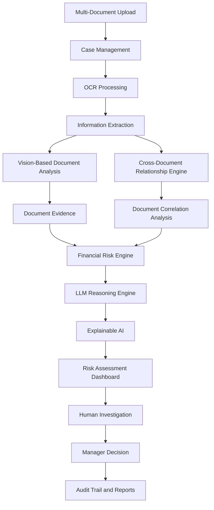
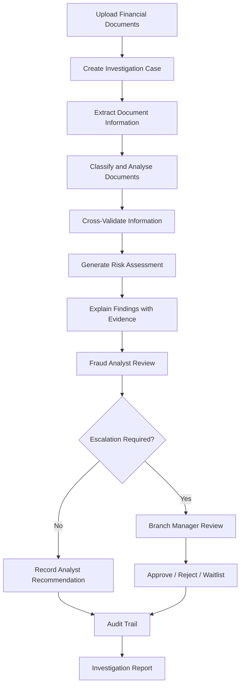

# SecureDocXAI

<p align="center">
  
</p>

<p align="center">
  <strong>Explainable AI-Based Multi-Document Fraud Detection and Financial Risk Scoring Using Vision Transformers and Large Language Models</strong>
</p>

<p align="center">
  
  
  
  
</p>

<p align="center">
  
  
  
  
  
</p>

---

## Overview

**SecureDocXAI** is an intelligent financial document analysis and fraud investigation platform designed to identify inconsistencies, suspicious patterns, and potential manipulation across multiple financial documents.

Traditional document verification systems often examine files individually. SecureDocXAI takes a broader approach by connecting information across an entire investigation case.

It combines document processing, information extraction, cross-document validation, financial risk assessment, and explainable AI to help investigators understand not only **what was flagged, but why it was flagged**.

The platform is designed around a case-based investigation workflow, enabling banking professionals to review related documents together, examine supporting evidence, and make informed decisions.

## The Idea

<p align="center">
  
  <br/>
  <strong>↓</strong>
  <br/>
  
</p>

Instead of asking whether one document looks valid, SecureDocXAI asks:

- Do the identity details match across documents?
- Does the salary in the payslip correspond to the bank statement?
- Are account numbers and IFSC details consistent?
- Are there suspicious transaction patterns?
- Does the document contain signs of possible alteration?
- What evidence supports the generated risk assessment?

**The objective is to transform document verification into evidence-driven financial fraud investigation.**

---

## Core Features

### 1. Multi-Document Investigation

Upload multiple financial and identity documents into a single investigation case.

Supported document categories are designed to include:

- Bank statements
- Salary slips
- PAN cards
- Aadhaar cards
- Loan applications
- GST documents
- Invoices
- Contracts
- Supporting financial records

Each document remains individually accessible while contributing to the overall case analysis.

### 2. Intelligent Document Processing

The document processing pipeline is designed to handle scanned and digital documents.

- Multi-page PDF processing
- OCR-based text extraction
- Structured field identification
- Table and transaction extraction
- Page-level references
- Extraction confidence tracking
- Coordinate-based evidence highlighting

### 3. Vision-Based Document Understanding

SecureDocXAI includes a modular vision-processing layer designed for integration with Vision Transformer-based document models.

Its intended responsibilities include:

- Document classification
- Layout understanding
- Structural region identification
- Table and text-region analysis
- Document quality assessment
- Visual anomaly and tampering indicators

The model layer is pluggable. Lightweight local processing can be used during prototype development, with real trained or pretrained models integrated through compatible adapters.

### 4. Cross-Document Relationship Engine

This is one of the central components of SecureDocXAI.

The relationship engine compares information across documents to identify conflicts that may not be visible when documents are examined separately.

| Validation Area | Example |
|---|---|
| Identity | Name mismatch between PAN and bank statement |
| Banking | Account number or IFSC inconsistency |
| Employment | Employer details differ across records |
| Salary | Payslip salary differs from bank credits |
| Transactions | Duplicate or suspicious transactions |
| Address | Conflicting addresses across documents |
| Financial | Inconsistent balances or reported income |

### 5. Financial Risk Scoring

The financial risk engine consolidates relevant evidence into a case-level risk assessment.

Risk indicators may include:

- Identity inconsistencies
- Financial inconsistencies
- Suspicious transactions
- Document alteration indicators
- Metadata inconsistencies
- Cross-document conflicts
- Duplicate submissions
- Extraction uncertainty

Risk categories:

<p align="center">
  
  
  
  
</p>

*These are illustrative risk bands; the final thresholds and scoring methodology should be documented and calibrated against an evaluation dataset.*

### 6. Explainable AI

A risk score without evidence is not enough.

Every finding is designed to provide:

- Detected anomaly
- Affected document
- Page number and field
- Extracted and expected values
- Supporting evidence
- Confidence indicator
- Explanation
- Recommended investigation action

The objective is to make AI-assisted fraud analysis understandable to human investigators.

### 7. LLM-Based Reasoning

The reasoning layer is designed to operate on extracted document information rather than replacing the OCR pipeline.

Its intended capabilities include:

- Cross-document inconsistency summaries
- Financial risk explanations
- Investigation report generation
- Natural-language document Q&A
- Evidence-based recommendations
- Investigator assistance

The LLM integration is modular, allowing different model providers or locally hosted models to be connected.

### 8. Role-Based Investigation Workflow

SecureDocXAI follows a structured human-review process.

| Role | Responsibility |
|---|---|
| Underwriting Officer | Upload documents and initiate reviews |
| Fraud Analyst | Investigate findings and recommend actions |
| Branch Manager | Make final case decisions |
| Compliance Auditor | Review records and audit history |
| System Administrator | Manage users, models, and configuration |

Automated risk assessments support the review process; final decisions remain subject to authorized human review.

---

## System Architecture

<p align="center">
  
</p>



### Modular Architecture

```text
SecureDocXAI/
│
├── frontend/
│   ├── components/
│   ├── pages/
│   ├── dashboards/
│   ├── cases/
│   └── investigation/
│
├── backend/
│   ├── api/
│   ├── models/
│   ├── services/
│   │   ├── ocr_engine.py
│   │   ├── vit_pipeline.py
│   │   ├── information_extraction.py
│   │   ├── relationship_engine.py
│   │   ├── financial_risk_engine.py
│   │   ├── llm_reasoning.py
│   │   └── explainable_ai.py
│   │
│   ├── database/
│   ├── authentication/
│   ├── workflow/
│   └── reporting/
│
├── tests/
├── docs/
└── README.md
```

*Illustrative logical structure; actual directories may differ in the repository.*

---

## Investigation Workflow



---

## What Makes SecureDocXAI Different?

| Conventional Verification | SecureDocXAI Approach |
|---|---|
| Individual document checking | Case-level multi-document analysis |
| Isolated field extraction | Cross-document relationship validation |
| Basic anomaly alerts | Evidence-linked fraud findings |
| Generic risk indicators | Financial risk assessment |
| Unexplained scores | Explainable AI reasoning |
| Manual document comparison | Automated consistency analysis |
| Fragmented review | Role-based investigation workflow |
| Limited traceability | Centralized audit history |

---

## Technology Stack

The application is developed around a modular architecture.

| Layer | Technology / Approach |
|---|---|
| Frontend | React |
| Backend | Python |
| Database | MongoDB |
| Document Processing | OCR and PDF processing |
| Vision Intelligence | Vision Transformer-compatible model layer |
| Language Intelligence | LLM integration layer |
| Risk Analysis | Financial rules and risk scoring |
| Explainability | Evidence-based reasoning |
| Workflow | Role-Based Access Control |

*The exact model implementations and deployed versions depend on the configured environment.*

---

## Research Direction

**Proposed Research Title**

*SecureDocXAI: Explainable AI-Based Multi-Document Fraud Detection and Financial Risk Scoring Using Vision Transformers and Large Language Models*

The research direction focuses on the integration of:

1. Multi-document financial information extraction.
2. Cross-document relationship and consistency analysis.
3. Vision-based document understanding.
4. Explainable financial fraud risk assessment.
5. LLM-assisted investigation and decision support.

The objective is to evaluate whether combining document intelligence, cross-document validation, and explainable reasoning can improve financial document fraud investigation.

---

## Getting Started

### Prerequisites

- Python
- Node.js and npm
- MongoDB
- Git

### Clone the Repository

Replace the repository address below with the actual GitHub repository URL.

```bash
git clone https://github.com/YOUR_USERNAME/SecureDocXAI.git
cd SecureDocXAI
```

### Installation

Install the backend and frontend dependencies using the project-specific dependency files.

```bash
# Backend
pip install -r requirements.txt

# Frontend
npm install
```

If the backend and frontend use separate directories, run these commands from their respective project folders.

### Configuration

Configure the MongoDB connection, application environment variables, authentication settings, and any optional AI model credentials using your local environment configuration.

Do not commit API keys, passwords, database credentials, or confidential financial documents to GitHub.

### Run the Application

Use the backend and frontend start commands defined in the project's configuration files.

---

## Security and Responsible Use

SecureDocXAI is designed for financial investigation and decision support.

- Protect sensitive personal and financial information.
- Restrict case access using role-based authorization.
- Maintain traceable investigation records.
- Treat OCR errors and model predictions as uncertain evidence.
- Require authorized human review before final financial decisions.
- Validate all model outputs before using them in operational workflows.

**A flagged document is not automatically proof of fraud.** Findings must be reviewed against their supporting evidence.

---

## Current Development Status

SecureDocXAI is being developed as a research-oriented prototype.

The architecture is designed to support modular AI integration, multi-document analysis, explainable risk assessment, and banking investigation workflows. Individual capabilities should be considered implemented only when they are available and verified in the current repository.

---

## Author

<p align="center">
  <strong>Developed as an AI-powered financial document intelligence and fraud investigation research project.</strong>
</p>

<p align="center">
  <em>Secure documents. Explainable intelligence. More informed decisions.</em>
</p>

---

<p align="center">
  
</p>
